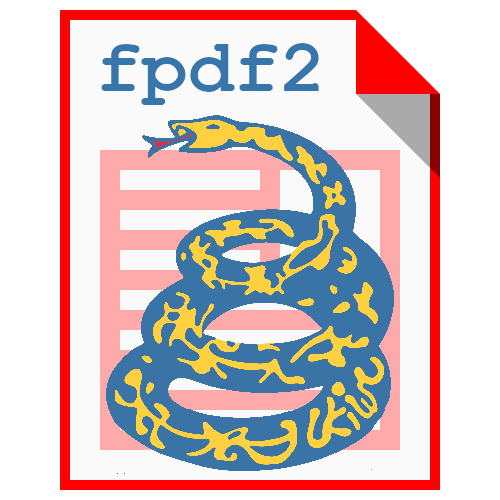
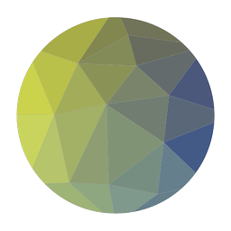

 

&nbsp;

&nbsp;

&nbsp;

&nbsp;

&nbsp;

---

### 🎙️ I explain one AI concept every day — in the simplest way possible.
**Follow along on YouTube · Instagram · X &nbsp;→&nbsp; `@aiwithrav`**

---

## 🌍 Open Source Contributions

**Merged code into libraries the AI/ML world actually uses.**

### How It All Connects

Every merged PR, carried on a C60 buckyball. Real geometry: 60 vertices, 90 bonds, 12 pentagons, 20 hexagons. <a href="https://chandan-kumar-ai-engineer.vercel.app/#graph">Spin the interactive version on my portfolio →</a>

 

  
  &nbsp;&nbsp;
  
  &nbsp;&nbsp;
  
  &nbsp;&nbsp;
  
  &nbsp;&nbsp;
  
  &nbsp;&nbsp;
  
  &nbsp;&nbsp;
  
  &nbsp;&nbsp;
  
  &nbsp;&nbsp;
  
  &nbsp;&nbsp;
  
  &nbsp;&nbsp;
  
  &nbsp;&nbsp;
  
  &nbsp;&nbsp;
  
  &nbsp;&nbsp;
  
  &nbsp;&nbsp;
  

[-10b981?style=for-the-badge&logo=github&logoColor=white)](https://github.com/joblib/joblib/pull/1812)
[-10b981?style=for-the-badge&logo=github&logoColor=white)](https://github.com/huggingface/sentence-transformers/pull/3855)
[-10b981?style=for-the-badge&logo=github&logoColor=white)](https://github.com/nltk/nltk/pull/3703)
[-10b981?style=for-the-badge&logo=github&logoColor=white)](https://github.com/py-pdf/pypdf/pull/3929)
[-10b981?style=for-the-badge&logo=github&logoColor=white)](https://github.com/authlib/authlib/pull/919)
[-10b981?style=for-the-badge&logo=github&logoColor=white)](https://github.com/py-pdf/fpdf2/pull/1984)
[-10b981?style=for-the-badge&logo=github&logoColor=white)](https://github.com/python-pillow/Pillow/pull/10146)
[-10b981?style=for-the-badge&logo=github&logoColor=white)](https://github.com/pydantic/pydantic-extra-types/pull/440)
[-10b981?style=for-the-badge&logo=github&logoColor=white)](https://github.com/neuml/txtai/pull/1408)
[-10b981?style=for-the-badge&logo=github&logoColor=white)](https://github.com/kornia/kornia/pull/5946)
[-10b981?style=for-the-badge&logo=github&logoColor=white)](https://github.com/tox-dev/tox/pull/4161)
[-10b981?style=for-the-badge&logo=github&logoColor=white)](https://github.com/lepture/mistune/pull/501)

[-10b981?style=for-the-badge&logo=github&logoColor=white)](https://github.com/mindee/doctr/pull/2187)
[-10b981?style=for-the-badge&logo=github&logoColor=white)](https://github.com/adbar/trafilatura/pull/984)

**171 merged pull requests across 16 libraries.** Grouped by project — click any row to expand.

| Library | Merged | Focus |
|---|---|---|
| [py-pdf/pypdf](https://github.com/py-pdf/pypdf) `10.3k★` | **76** | Reader robustness, typing, spec compliance |
| [huggingface/sentence-transformers](https://github.com/huggingface/sentence-transformers) `18.9k★` | **2** | Regression tests, docs |
| [joblib/joblib](https://github.com/joblib/joblib) `4.1k★` | **3** | Input validation, path handling |
| [nltk/nltk](https://github.com/nltk/nltk) `14.7k★` | **1** | Regression tests, argument validation |
| [authlib/authlib](https://github.com/authlib/authlib) `5.4k★` | **2** | OAuth correctness |
| [fonttools/fonttools](https://github.com/fonttools/fonttools) `5.3k★` | **7** | CFF round-trip, feaLib spec compliance |
| [py-pdf/fpdf2](https://github.com/py-pdf/fpdf2) `1.5k★` | **46** | HTML rendering robustness |
| [python-pillow/Pillow](https://github.com/python-pillow/Pillow) `13.9k★` | **4** | Image decoder robustness |
| [pydantic/pydantic-extra-types](https://github.com/pydantic/pydantic-extra-types) `339★` | **5** | Validation of real-world input |
| [neuml/txtai](https://github.com/neuml/txtai) `13k★` | **2** | HTML to Markdown fidelity |
| [kornia/kornia](https://github.com/kornia/kornia) `11.4k★` | **1** | Integer-image handling in filters |
| [tox-dev/tox](https://github.com/tox-dev/tox) `4k★` | **1** | Configuration correctness |
| [lepture/mistune](https://github.com/lepture/mistune) `3.1k★` | **1** | Markdown round-trip rendering |
| [docling-project/docling-core](https://github.com/docling-project/docling-core) `294★` | **1** | Markdown serialization correctness |
| [mindee/doctr](https://github.com/mindee/doctr) `6.4k★` | **15** | Document model robustness |
| [adbar/trafilatura](https://github.com/adbar/trafilatura) `7k★` | **4** | Markdown output fidelity |

<b>py-pdf/pypdf</b> &nbsp;<code>10.3k★</code> &nbsp;—&nbsp; 76 merged &nbsp;<i>(click to expand)</i>

| PR | Contribution |
|---|---|
| [#4271](https://github.com/py-pdf/pypdf/pull/4271) | Robustness: a page labels `/Nums` entry that is not an array made `reader.page_labels` raise `TypeError`; it now warns and falls back to the page position |
| [#4256](https://github.com/py-pdf/pypdf/pull/4256) | Robustness: an embedded file entry that is not a dictionary made `reader.attachments` raise `TypeError`; it is now reported as malformed and skipped (`PdfReadError` in strict mode) |
| [#4232](https://github.com/py-pdf/pypdf/pull/4232) | Robustness: a `Tc`, `Tw`, `Tz`, `TL` or `Ts` operator without an operand made layout-mode `extract_text()` raise `IndexError`; the parameter now keeps its current value |
| [#4242](https://github.com/py-pdf/pypdf/pull/4242) | Robustness: a `BT` inside a text object made layout-mode `extract_text()` print text twice or drop it; a nested `BT` now only resets the text matrix, as in plain mode |
| [#4233](https://github.com/py-pdf/pypdf/pull/4233) | Robustness: a `TD` operator with a name instead of a number raised `TypeError` in plain and layout mode, and one with too few operands raised `IndexError` in layout mode; the leading now only changes for a number and the text is kept |
| [#4228](https://github.com/py-pdf/pypdf/pull/4228) | Robustness: a `Tf` operator with a missing size or no operands made layout-mode `extract_text()` raise `IndexError`; the current size and a placeholder font are kept, as in plain mode |
| [#4214](https://github.com/py-pdf/pypdf/pull/4214) | Robustness: a non-numeric operand of `Tc`, `Tw`, `Tz`, `TL`, `Ts`, `Td` or `Tm` made layout-mode `extract_text()` raise; the parameter is now left unchanged and the text kept |
| [#4203](https://github.com/py-pdf/pypdf/pull/4203) | Robustness: a `'` or `"` operator without a string made layout-mode `extract_text()` raise; the line move is kept and only the text skipped, matching plain mode |
| [#4186](https://github.com/py-pdf/pypdf/pull/4186) | Robustness: a name, nested array or dictionary inside a `TJ` array crashed layout-mode `extract_text()` and printed names as text; such items are now skipped |
| [#4175](https://github.com/py-pdf/pypdf/pull/4175) | Robustness: a non-numeric operand of `Td`, `TL`, `Tz` or `Tw` made `extract_text()` raise; it is now treated as missing and the text kept |
| [#4174](https://github.com/py-pdf/pypdf/pull/4174) | Robustness: text with a font size of 0 made layout-mode `extract_text()` divide by a zero width; the text is now extracted |
| [#4171](https://github.com/py-pdf/pypdf/pull/4171) | Robustness: a `Tj` operator with a number instead of a string made `extract_text()` raise `TypeError`; it is now skipped and the text around it kept |
| [#4166](https://github.com/py-pdf/pypdf/pull/4166) | Robustness: a `TJ` operator with a number instead of an array made `extract_text()` raise `TypeError`; it is now skipped and the text around it kept |
| [#4165](https://github.com/py-pdf/pypdf/pull/4165) | Robustness: a bare `Do` operator made `extract_text()` raise `IndexError` from inside its own warning; it is now skipped and the text around it kept |
| [#4163](https://github.com/py-pdf/pypdf/pull/4163) | Robustness: a `/FirstChar` that is null, a name or a string crashed layout-mode `extract_text()` with `TypeError` |
| [#4155](https://github.com/py-pdf/pypdf/pull/4155) | Bug fix (6.19.0 regression): text shown before a change of direction, such as digits beside Arabic, was dropped from `extract_text()` |
| [#4138](https://github.com/py-pdf/pypdf/pull/4138) | Robustness: a `/Font` resource that is a number, string or array crashed `extract_text()` with `TypeError`, in plain and layout mode |
| [#4123](https://github.com/py-pdf/pypdf/pull/4123) | Bug fix: a malformed rectangle failed with a bare `AssertionError` that vanished under `python -O`; it now raises a `ValueError` naming the values |
| [#4098](https://github.com/py-pdf/pypdf/pull/4098) | Robustness: an outline `/A` action missing the required `/S` subtype raised `KeyError`, making the whole outline unreadable |
| [#4119](https://github.com/py-pdf/pypdf/pull/4119) | Robustness: a `/Type0` font omitting `/DescendantFonts` raised a bare `KeyError` out of `extract_text()` |
| [#4118](https://github.com/py-pdf/pypdf/pull/4118) | Robustness: a `/Widths` entry holding a string was passed to `int()`, raising `ValueError` during text extraction |
| [#4102](https://github.com/py-pdf/pypdf/pull/4102) | Robustness: a `/Kids` entry that is not an array crashed `reader.page_labels` |
| [#4099](https://github.com/py-pdf/pypdf/pull/4099) | Bug fix: `add_named_destination` wrote a hardcoded `/FitH` top of 826, pointing viewers past the top of the page |
| [#4080](https://github.com/py-pdf/pypdf/pull/4080) | Robustness: `add_outline_item` raised `UnboundLocalError` instead of naming an unsupported `page_number` type |
| [#4074](https://github.com/py-pdf/pypdf/pull/4074) | Bug fix: a string `rect` for `add_uri` collapsed to `0`, leaving the link with no clickable area |
| [#4069](https://github.com/py-pdf/pypdf/pull/4069) | Robustness: `insert_blank_page` looked up the size of a page that did not exist yet on an empty writer |
| [#4064](https://github.com/py-pdf/pypdf/pull/4064) | Robustness: a malformed `/XFA` entry raised `TypeError` or `StopIteration` out of `reader.xfa` |
| [#4058](https://github.com/py-pdf/pypdf/pull/4058) | Robustness: a font `/Encoding` whose `/Differences` is not an array crashed text extraction |
| [#4054](https://github.com/py-pdf/pypdf/pull/4054) | Robustness: page `/Resources` that is not a dictionary crashed `extract_text()` on the `/Font` lookup |
| [#4048](https://github.com/py-pdf/pypdf/pull/4048) | Robustness: a `/Kids` entry that is not a dictionary crashed the page tree walk |
| [#4046](https://github.com/py-pdf/pypdf/pull/4046) | Robustness: an `/Annots` entry that is not an array crashed anything iterating `page.annotations` |
| [#4041](https://github.com/py-pdf/pypdf/pull/4041) | Robustness: a page box that is not an array failed with an error naming neither the box nor the problem |
| [#4039](https://github.com/py-pdf/pypdf/pull/4039) | Robustness: a name tree node whose `/Names` or `/Kids` is not an array crashed `reader.named_destinations` |
| [#4038](https://github.com/py-pdf/pypdf/pull/4038) | Typing: `read_object` was annotated to return an `int` or `str` it can never produce, forcing six suppressions across its callers |
| [#4031](https://github.com/py-pdf/pypdf/pull/4031) | Robustness: a form field entry that is not a dictionary crashed `reader.get_fields()` |
| [#4030](https://github.com/py-pdf/pypdf/pull/4030) | Robustness: `/XObject` resources that are not a dictionary crashed `page.images` |
| [#4029](https://github.com/py-pdf/pypdf/pull/4029) | Robustness: an `/AcroForm` entry that is not a dictionary crashed `reader.get_fields()` |
| [#4023](https://github.com/py-pdf/pypdf/pull/4023) | Robustness: an `/Outlines` entry that is not a dictionary crashed `reader.outline` |
| [#4022](https://github.com/py-pdf/pypdf/pull/4022) | Robustness: a malformed `/PageLabels` entry crashed `reader.page_labels` |
| [#4021](https://github.com/py-pdf/pypdf/pull/4021) | Robustness: a malformed `/ViewerPreferences` entry raised `AttributeError` |
| [#4020](https://github.com/py-pdf/pypdf/pull/4020) | Robustness: a malformed `/Dests` or `/Names` entry crashed `reader.named_destinations` |
| [#4019](https://github.com/py-pdf/pypdf/pull/4019) | Robustness: a malformed AcroForm `/Fields` entry crashed `get_fields()` |
| [#4018](https://github.com/py-pdf/pypdf/pull/4018) | Robustness: an outline node that is not a dictionary crashed `reader.outline` |
| [#4017](https://github.com/py-pdf/pypdf/pull/4017) | An unknown page label style was written into `/S` and then silently dropped on read |
| [#4016](https://github.com/py-pdf/pypdf/pull/4016) | An out-of-range page surfaced as a bare `IndexError` from the kids array |
| [#4014](https://github.com/py-pdf/pypdf/pull/4014) | The four area and clip preferences were declared with no acceptable values, so any name passed |
| [#4013](https://github.com/py-pdf/pypdf/pull/4013) | `/PrintPageRange` holds page pairs, so an odd-length array leaves a range without its end |
| [#4012](https://github.com/py-pdf/pypdf/pull/4012) | `/NumCopies` accepted a negative count no reader can interpret |
| [#4011](https://github.com/py-pdf/pypdf/pull/4011) | `/PrintScaling` was declared with an empty list of acceptable values, so nothing checked it |
| [#4010](https://github.com/py-pdf/pypdf/pull/4010) | Bug fix: the page layout warning printed a set of an empty string and every layout run together |
| [#4009](https://github.com/py-pdf/pypdf/pull/4009) | A page box could be set to two values but not read back, since the getter needs four |
| [#4005](https://github.com/py-pdf/pypdf/pull/4005) | Bug fix: `number2uppercase_roman_numeral(-1)` returned `CMXCIX` instead of refusing a non-positive number |
| [#4004](https://github.com/py-pdf/pypdf/pull/4004) | Bug fix: `PageRange("::0")` was accepted and reported valid, but the range only failed once applied |
| [#4003](https://github.com/py-pdf/pypdf/pull/4003) | Form field flags were passed as a bare `1` where the docs point at the `FfBits` enum |
| [#4002](https://github.com/py-pdf/pypdf/pull/4002) | Bug fix: two callers passed the raw `/Font` entry to a function reading it as a dictionary - it worked only because `IndirectObject` forwards attributes |
| [#4000](https://github.com/py-pdf/pypdf/pull/4000) | expat passes an `int` for `is_parameter_entity` while typeshed declares a `bool` - records why the annotation stays |
| [#3997](https://github.com/py-pdf/pypdf/pull/3997) | The docs set `annotation.flags = 4` under a comment pointing readers at `AnnotationFlag` |
| [#3996](https://github.com/py-pdf/pypdf/pull/3996) | Bug fix: a CID font's `/W` array may hold real numbers, so a width of `443.35938` landed in a `dict[str, int]` |
| [#3995](https://github.com/py-pdf/pypdf/pull/3995) | `XmpInformation` was typed for a `ContentStream`, a sibling of the `DecodedStreamObject` the `/Metadata` stream actually is |
| [#3991](https://github.com/py-pdf/pypdf/pull/3991) | The annotation `border` was declared an `ArrayObject` while the documented usage is a plain list |
| [#3990](https://github.com/py-pdf/pypdf/pull/3990) | `Fit` was typed for a tuple, but the destination builder unpacks the PDF array and hands over a list |
| [#3989](https://github.com/py-pdf/pypdf/pull/3989) | The layout-mode extractor passes a `ChainMap` into a function annotated for two lists, behind a `type: ignore` |
| [#3988](https://github.com/py-pdf/pypdf/pull/3988) | Both name-tree walks cast to `TreeObject` on objects that are plain dictionaries at runtime |
| [#3986](https://github.com/py-pdf/pypdf/pull/3986) | The annotation list holds `IndirectObject` references, not the `DictionaryObject` it was declared as |
| [#3985](https://github.com/py-pdf/pypdf/pull/3985) | Returned two empty lists from a function annotated `None`, hidden behind a `type: ignore` |
| [#3984](https://github.com/py-pdf/pypdf/pull/3984) | Bug fix: `RectangleObject` was typed for a tuple, but every caller inside pypdf passes the `ArrayObject` read from the PDF |
| [#3983](https://github.com/py-pdf/pypdf/pull/3983) | Bug fix: iterating a PDF dictionary yields keys, so the AcroForm font walk collected nothing — form fields inheriting a document-level font came back with an empty font set |
| [#3972](https://github.com/py-pdf/pypdf/pull/3972) | A compressed cross-reference stream is an `EncodedStreamObject`, a sibling of the `ContentStream` it was declared as |
| [#3971](https://github.com/py-pdf/pypdf/pull/3971) | Bug fix: a stream without an explicit `/DecodeParms` handed every filter a plain `dict`, but the decoders are typed for a `DictionaryObject` |
| [#3970](https://github.com/py-pdf/pypdf/pull/3970) | Bug fix: the object-translation table is declared `int`-to-`int`, but each entry also stores the source document under a `"PreventGC"` key — two `type: ignore` comments hid the mismatch |
| [#3969](https://github.com/py-pdf/pypdf/pull/3969) | Release tooling: the version bump always assumed a patch release, so enhancements had to be corrected by hand — now derived from the generated changelog sections |
| [#3960](https://github.com/py-pdf/pypdf/pull/3960) | Bug fix: `PdfWriterProtocol` declares `_reader`, but `PdfWriter` only set it in incremental mode — so a normal writer failed the protocol it is passed as |
| [#3957](https://github.com/py-pdf/pypdf/pull/3957) | Bug fix: `pages` was annotated `list[PageObject]` but returns a lazy `_VirtualList`, so type checkers accepted `reader.pages.append(...)` — which raises at runtime |
| [#3943](https://github.com/py-pdf/pypdf/pull/3943) | Bug fix: an explicit `/Decode` array replaced the Adobe CMYK inversion instead of composing with it, leaving extracted images colour-inverted |
| [#3938](https://github.com/py-pdf/pypdf/pull/3938) | Bug fix: low-bit expansion never ran for unfiltered/inline images, raising `unrecognized image mode` |
| [#3929](https://github.com/py-pdf/pypdf/pull/3929) | Bug fix: low-bit `/DeviceRGB` images decoded as RGB instead of palette — broken image extraction |

<b>huggingface/sentence-transformers</b> &nbsp;<code>18.9k★</code> &nbsp;—&nbsp; 2 merged &nbsp;<i>(click to expand)</i>

| PR | Contribution |
|---|---|
| [#3855](https://github.com/huggingface/sentence-transformers/pull/3855) | Regression tests for a core utility |
| [#3843](https://github.com/huggingface/sentence-transformers/pull/3843) | Documented the sparse-tensor → SciPy COO conversion |

<b>joblib/joblib</b> &nbsp;<code>4.1k★</code> &nbsp;—&nbsp; 3 merged &nbsp;<i>(click to expand)</i>

| PR | Contribution |
|---|---|
| [#1839](https://github.com/joblib/joblib/pull/1839) | Input validation: a `pre_dispatch` below one dispatched nothing and returned no results |
| [#1812](https://github.com/joblib/joblib/pull/1812) | Bug fix: accept any `os.PathLike` in `dump()`/`load()` |
| [#1811](https://github.com/joblib/joblib/pull/1811) | Docstrings for time-format helpers |

<b>nltk/nltk</b> &nbsp;<code>14.7k★</code> &nbsp;—&nbsp; 1 merged &nbsp;<i>(click to expand)</i>

| PR | Contribution |
|---|---|
| [#3703](https://github.com/nltk/nltk/pull/3703) | Regression tests for `transitive_closure` — cycles, reflexive closure, and input-mutation safety |

<b>authlib/authlib</b> &nbsp;<code>5.4k★</code> &nbsp;—&nbsp; 2 merged &nbsp;<i>(click to expand)</i>

| PR | Contribution |
|---|---|
| [#926](https://github.com/authlib/authlib/pull/926) | Consistency: `extract_params("")` returned `None` though the function documents `[]` for an empty string, dict or list; the empty string now matches |
| [#919](https://github.com/authlib/authlib/pull/919) | Bug fix: the OAuth1 `InsecureTransportError` carried the OAuth2 description, telling OAuth 1.0a clients "OAuth 2 MUST utilize https." — merged by the project lead |

<b>fonttools/fonttools</b> &nbsp;<code>5.3k★</code> &nbsp;—&nbsp; 7 merged &nbsp;<i>(click to expand)</i>

| PR | Contribution |
|---|---|
| [#4269](https://github.com/fonttools/fonttools/pull/4269) | Bug fix: a non-ASCII OS/2 `Vendor` compiled and then crashed on save with `UnicodeEncodeError`; feaLib now rejects it with the line |
| [#4268](https://github.com/fonttools/fonttools/pull/4268) | Bug fix: a STAT axis location with no or too many values was skipped and crashed later with `KeyError`; feaLib now rejects it with the line |
| [#4267](https://github.com/fonttools/fonttools/pull/4267) | Bug fix: a name string feaLib could not encode or decode (an unpaired surrogate, an emoji in Mac Roman) raised a bare `UnicodeError`; it now raises `FeatureLibError` at the string |
| [#4266](https://github.com/fonttools/fonttools/pull/4266) | Bug fix: a `UnicodeRange` bit outside 0-127 passed the feaLib parser and failed later with a bare `ValueError`; it now raises `FeatureLibError` with the line |
| [#4263](https://github.com/fonttools/fonttools/pull/4263) | Bug fix: a `BaseScriptList` without a matching `BaseTagList` crashed feaLib with `UnboundLocalError` or a bare `ValueError`; both now raise `FeatureLibError` with the line |
| [#4259](https://github.com/fonttools/fonttools/pull/4259) | Bug fix: feaLib wrote a short OS/2 Vendor ID padded with NUL bytes; it is now padded with spaces as the OpenType spec requires |
| [#4253](https://github.com/fonttools/fonttools/pull/4253) | Bug fix: a CFF font with a non-ASCII name could be saved but not read back — the Name INDEX was decoded as ASCII while the compiler writes latin-1 |

<b>py-pdf/fpdf2</b> &nbsp;<code>1.5k★</code> &nbsp;—&nbsp; 46 merged &nbsp;<i>(click to expand)</i>

| PR | Contribution |
|---|---|
| [#2089](https://github.com/py-pdf/fpdf2/pull/2089) | Robustness: `table()` with a negative `gutter_height` or `gutter_width` drew rows or columns on top of each other; it now raises a clear `ValueError` |
| [#2088](https://github.com/py-pdf/fpdf2/pull/2088) | Robustness: `text_columns()` with a negative `gutter` laid out overlapping columns printed on top of each other; it now raises a clear `ValueError` |
| [#2083](https://github.com/py-pdf/fpdf2/pull/2083) | Robustness: `set_font()` and `set_font_size()` accepted a negative size, mirroring the text and moving `multi_cell()` lines above the top margin; they now raise a clear `ValueError` |
| [#2084](https://github.com/py-pdf/fpdf2/pull/2084) | Robustness: `set_auto_page_break()` with a negative margin put the page break below the page, so the last lines before each break were lost off the page; it now raises a clear `ValueError` |
| [#2082](https://github.com/py-pdf/fpdf2/pull/2082) | Robustness: `set_stretching()` with zero or a negative value gave text no width, so justified text collapsed onto one line; it now raises a clear `ValueError` |
| [#2079](https://github.com/py-pdf/fpdf2/pull/2079) | Robustness: `set_display_mode()` wrote a negative zoom into the PDF and failed late on a non-numeric one; both now raise a clear `FPDFException` |
| [#2078](https://github.com/py-pdf/fpdf2/pull/2078) | Robustness: `table(borders_layout=...)` with an unknown value crashed with a bare `AttributeError`; it now raises its intended `ValueError`, like `cell_fill_mode` and `v_align` |
| [#2075](https://github.com/py-pdf/fpdf2/pull/2075) | Correctness: an invalid CSS color on a heading (`<h1 style="color: nope">`) crashed `write_html()`; it is now ignored with a warning, like browsers do |
| [#2077](https://github.com/py-pdf/fpdf2/pull/2077) | Robustness: a custom page format with a width or height of zero or below wrote an invalid `/MediaBox`; it now raises a clear `FPDFPageFormatException` |
| [#2076](https://github.com/py-pdf/fpdf2/pull/2076) | Robustness: `set_line_width()` accepted a negative width and wrote it into the PDF; it now raises a clear `ValueError` |
| [#2069](https://github.com/py-pdf/fpdf2/pull/2069) | Robustness: `regular_polygon()` with `numSides` below 1 silently wrote a path with no points; it now raises a clear `ValueError` |
| [#2068](https://github.com/py-pdf/fpdf2/pull/2068) | Correctness: `ink_annotation()` built the rectangle's x from the y coordinates, so `/Rect` did not enclose the drawn path and could lie outside the page; it now uses the x coordinates |
| [#2067](https://github.com/py-pdf/fpdf2/pull/2067) | Robustness: `add_page()`/`set_page_label()` with `label_start` below 1 wrote an invalid `/St` value; they now raise a clear `ValueError` |
| [#2066](https://github.com/py-pdf/fpdf2/pull/2066) | Robustness: `star()` with `corners` below 1 crashed with a `ZeroDivisionError` or silently drew nothing; it now raises a clear `ValueError` |
| [#2063](https://github.com/py-pdf/fpdf2/pull/2063) | Robustness: `text_columns()` with `ncols` below 1 crashed with a `ZeroDivisionError` or an unrelated "Not enough horizontal space" error; it now raises a clear `ValueError` |
| [#2062](https://github.com/py-pdf/fpdf2/pull/2062) | Correctness: a repeated style letter such as `style="BB"` was not recognised as bold in `set_font()`/`add_font()`; a repeated letter now means the same style |
| [#2061](https://github.com/py-pdf/fpdf2/pull/2061) | Usability: an out-of-range color component was reported as its scaled value (`1.17... not in range [0.0, 1.0]`); it is now reported as given (`300 not in range [0, 255]`) |
| [#2060](https://github.com/py-pdf/fpdf2/pull/2060) | Correctness: a hex color with non-hexadecimal characters, such as `"#GG0000"`, was silently turned into a wrong color; it now raises a clear `ValueError` |
| [#2059](https://github.com/py-pdf/fpdf2/pull/2059) | Robustness: an internal link number that `add_link()` did not return raised a bare `AssertionError`; it now raises a clear `ValueError` |
| [#2058](https://github.com/py-pdf/fpdf2/pull/2058) | Robustness: a table `colspan` below 1 crashed or broke the layout; it now spans one column, like `rowspan` |
| [#2056](https://github.com/py-pdf/fpdf2/pull/2056) | Robustness: a `table()` `text_align` tuple shorter than the columns crashed with a bare `IndexError`; it now raises a clear `ValueError` like `col_widths` |
| [#2055](https://github.com/py-pdf/fpdf2/pull/2055) | Correctness: an empty or unknown `<ul type>` raised `NotImplementedError`; it now keeps the default bullet, like browsers and like `<ol>` |
| [#2053](https://github.com/py-pdf/fpdf2/pull/2053) | Correctness: `<meta>`, `<link>`, `<col>`, `<wbr>` and the other HTML void elements produced bogus "missing end tag" warnings; they are now handled like ` ` |
| [#2052](https://github.com/py-pdf/fpdf2/pull/2052) | Robustness: a `<table>` nested in a table cell crashed with a bare `AssertionError`; it now raises a clear `NotImplementedError` like other unsupported nested tags |
| [#2035](https://github.com/py-pdf/fpdf2/pull/2035) | Correctness: a first row giving a `width` to only some cells raised `ValueError`; the cells without one now share the rest of the table width, as browsers do (colspan and cellspacing included after review) |
| [#2044](https://github.com/py-pdf/fpdf2/pull/2044) | Correctness: the content of `<style>` and `<script>` was written into the PDF as visible text; it is now skipped, as browsers do |
| [#2034](https://github.com/py-pdf/fpdf2/pull/2034) | Browser parity: a CSS `font-size` on `` with a unit (`14pt`, `12px`) was silently ignored; the unit is now read, and a bare number is still in points |
| [#2032](https://github.com/py-pdf/fpdf2/pull/2032) | Browser parity: `<li value="N">` was ignored; the item is now numbered N and the next ones continue from it, in every list type |
| [#2031](https://github.com/py-pdf/fpdf2/pull/2031) | Browser parity: `<td rowspan="99">` near the end of a table raised `Rowspan extends beyond end of table`; the rowspan now stops at the last row, as in browsers |
| [#2009](https://github.com/py-pdf/fpdf2/pull/2009) | Browser parity: `` raised `Undefined font`; the first available font is now used, keeping the PDF/A check and bold/italic |
| [#2017](https://github.com/py-pdf/fpdf2/pull/2017) | Robustness: `<table width="150%">` raised `ValueError`; the table is now fitted to the page width with a warning, and a negative width is ignored |
| [#2013](https://github.com/py-pdf/fpdf2/pull/2013) | Browser parity: `<ul type="none">` raised `NotImplementedError`; it now renders as a plain indented list with no marker |
| [#2010](https://github.com/py-pdf/fpdf2/pull/2010) | Robustness: `bgcolor="transparent"` raised `ValueError`; like browsers it is now ignored and the inherited text or row background color is kept |
| [#2011](https://github.com/py-pdf/fpdf2/pull/2011) | Robustness: `<ol type="disc">` (an unknown list type) raised `NotImplementedError`; like browsers, the list is now numbered 1, 2, 3 |
| [#2003](https://github.com/py-pdf/fpdf2/pull/2003) | Robustness: `bgcolor="eeeeee"` (six hex digits without `#`, common in email HTML) raised `ValueError`; it is now read like browsers do |
| [#2002](https://github.com/py-pdf/fpdf2/pull/2002) | Robustness: `<ul type="CIRCLE">` raised `NotImplementedError`; list type keywords are now case-insensitive like in browsers |
| [#2001](https://github.com/py-pdf/fpdf2/pull/2001) | Feature gap: css `rgb(100%, 0%, 50%)` raised `ValueError` in SVG import and `write_html()`; percentages are now read and clamped to 0-100% |
| [#2000](https://github.com/py-pdf/fpdf2/pull/2000) | SVG import: a `<polygon>` / `<polyline>` with an odd number of coordinates or empty `points` raised `IndexError`; it now draws up to the first error, as the spec says |
| [#1998](https://github.com/py-pdf/fpdf2/pull/1998) | SVG import: opacity percentages (`50%`) and an out-of-range `opacity` raised `ValueError`; percentages are read and opacity is clamped to 0-1 |
| [#1997](https://github.com/py-pdf/fpdf2/pull/1997) | SVG import: `fill="transparent"` and upper-case color keywords raised `ValueError`; transparent now paints nothing and keywords are case-insensitive |
| [#1992](https://github.com/py-pdf/fpdf2/pull/1992) | Robustness: an unsupported `align` on table cells (e.g. `middle`) raised `ValueError`; it is now ignored, keeping `<th>` centered |
| [#1991](https://github.com/py-pdf/fpdf2/pull/1991) | Robustness: css `rgb(...)` colors in `color` / `bgcolor` raised `ValueError`; they now reuse the existing rgb() parser |
| [#1990](https://github.com/py-pdf/fpdf2/pull/1990) | Bug fix: invalid table `colspan` / `rowspan` raised `ValueError` or `ZeroDivisionError`; spans are now read like browsers do |
| [#1989](https://github.com/py-pdf/fpdf2/pull/1989) | Feature gap: `<ul type="square">`, a standard HTML bullet type, raised `NotImplementedError`; it now renders ▪ (or the closest core-font bullet) |
| [#1987](https://github.com/py-pdf/fpdf2/pull/1987) | Bug fix: an `<ol type="a">` list with more than 26 items crashed `write_html()` with `IndexError`; markers now continue like browsers (aa, ab, ...) |
| [#1984](https://github.com/py-pdf/fpdf2/pull/1984) | Bug fix: `write_html()` raised `KeyError: 'href'` on a named anchor (`<a name="intro">`); its text is now rendered as plain text |

<b>python-pillow/Pillow</b> &nbsp;<code>13.9k★</code> &nbsp;—&nbsp; 4 merged &nbsp;<i>(click to expand)</i>

| PR | Contribution |
|---|---|
| [#10174](https://github.com/python-pillow/Pillow/pull/10174) | Feature gap: `ImageOps.invert()`, `posterize()` and `solarize()` raised `NotImplementedError` for P images; the table is now applied to the palette, matching the RGB result |
| [#10177](https://github.com/python-pillow/Pillow/pull/10177) | Robustness: `Exif.get_ifd()` raised `KeyError` for a missing Interop or MakerNote IFD (most images); it now returns `{}` like the other IFDs |
| [#10173](https://github.com/python-pillow/Pillow/pull/10173) | Validation: `ImageOps.posterize()` bits outside the documented 1-8 crashed or silently returned black; it now raises `ValueError` |
| [#10146](https://github.com/python-pillow/Pillow/pull/10146) | Robustness: a truncated or corrupt gzip FITS image raised a raw `zlib.error` or `EOFError`; both are now raised as `OSError`, which callers catch for broken images |

<b>pydantic/pydantic-extra-types</b> &nbsp;<code>339★</code> &nbsp;—&nbsp; 5 merged &nbsp;<i>(click to expand)</i>

| PR | Contribution |
|---|---|
| [#454](https://github.com/pydantic/pydantic-extra-types/pull/454) | Real-world input: ISO 15924 script codes rejected `latn`, `LATN` and `" Latn "`; any case and surrounding whitespace are now accepted and normalised to `Latn` |
| [#451](https://github.com/pydantic/pydantic-extra-types/pull/451) | Real-world input: currency, country and language codes with surrounding whitespace such as `" USD "` were rejected; ten types now strip it |
| [#447](https://github.com/pydantic/pydantic-extra-types/pull/447) | CSS parity: `Color("rebeccapurple")` (CSS Color Level 4) was rejected; it now parses and `as_named()` returns it |
| [#442](https://github.com/pydantic/pydantic-extra-types/pull/442) | Consistency: a color name with surrounding whitespace (`"red "`) was rejected while hex and `rgba()` allowed it; names now accept it too |
| [#440](https://github.com/pydantic/pydantic-extra-types/pull/440) | Real-world input: ISBNs written with hyphens or spaces (`978-3-16-148410-0`, as printed on books) were rejected; they are now validated like the plain digits |

<b>neuml/txtai</b> &nbsp;<code>13k★</code> &nbsp;—&nbsp; 2 merged &nbsp;<i>(click to expand)</i>

| PR | Contribution |
|---|---|
| [#1422](https://github.com/neuml/txtai/pull/1422) | Fidelity: a list inside a blockquote became `> FirstSecond` with compact HTML; it now keeps its `-` / `1.` markers, one item per line |
| [#1408](https://github.com/neuml/txtai/pull/1408) | Fidelity: paragraphs inside a blockquote were joined with no separator (`> FirstSecond`); each now starts on its own line |

<b>kornia/kornia</b> &nbsp;<code>11.4k★</code> &nbsp;—&nbsp; 1 merged &nbsp;<i>(click to expand)</i>

| PR | Contribution |
|---|---|
| [#5946](https://github.com/kornia/kornia/pull/5946) | Robustness: `unsharp_mask` raised `RuntimeError` for a uint8 image; integer images are now promoted to float32 first, like `guided_blur` |

<b>tox-dev/tox</b> &nbsp;<code>4k★</code> &nbsp;—&nbsp; 1 merged &nbsp;<i>(click to expand)</i>

| PR | Contribution |
|---|---|
| [#4161](https://github.com/tox-dev/tox/pull/4161) | Correctness: `export KEY=value` in a `set_env` env file set a variable named `export KEY`; the leading `export` is now dropped, as dotenv and Docker Compose do |

<b>lepture/mistune</b> &nbsp;<code>3.1k★</code> &nbsp;—&nbsp; 1 merged &nbsp;<i>(click to expand)</i>

| PR | Contribution |
|---|---|
| [#501](https://github.com/lepture/mistune/pull/501) | Round trip: `MarkdownRenderer` raised for the strikethrough, mark and insert plugins; it now writes them back as `~~`, `==` and `^^`, nested formatting included |

<b>docling-project/docling-core</b> &nbsp;<code>294★</code> &nbsp;—&nbsp; 1 merged &nbsp;<i>(click to expand)</i>

| PR | Contribution |
|---|---|
| [#872](https://github.com/docling-project/docling-core/pull/872) | Correctness: a section header at level 6 or deeper was serialized with seven or more `#` and rendered as plain text; the Markdown serializer now caps it at six, like the HTML one caps at `<h6>` |

<b>mindee/doctr</b> &nbsp;<code>6.4k★</code> &nbsp;—&nbsp; 15 merged &nbsp;<i>(click to expand)</i>

| PR | Contribution |
|---|---|
| [#2193](https://github.com/mindee/doctr/pull/2193) | Correctness: `rotate_abs_points` and `rotate_boxes` truncated the rotation matrix to integers for integer coordinates, collapsing them; it is now built in floating point |
| [#2191](https://github.com/mindee/doctr/pull/2191) | Robustness: `crop_detection` raised `ValueError` on an image without any box; empty box arrays are now returned as is and the image is still cropped |
| [#2202](https://github.com/mindee/doctr/pull/2202) | Robustness: `Block()` and `Line([])` crashed with a bare `IndexError`; they now raise a `ValueError` saying the geometry has to be passed |
| [#2200](https://github.com/mindee/doctr/pull/2200) | Correctness: `extract_crops` gave an empty or wrong crop for a box going past the image edge; coordinates are now clamped to the image |
| [#2199](https://github.com/mindee/doctr/pull/2199) | Correctness: `remap_boxes` truncated integer boxes to zero; they are now remapped in floating point |
| [#2198](https://github.com/mindee/doctr/pull/2198) | Correctness: `polygon_patch` scaled the geometry passed to it in place, overwriting a word's relative coordinates; the patch is now built from a scaled copy |
| [#2197](https://github.com/mindee/doctr/pull/2197) | Robustness: `straighten_page` crashed on grayscale pages; `(H, W)` and `(H, W, 1)` pages are now straightened like each channel of a color page |
| [#2195](https://github.com/mindee/doctr/pull/2195) | Robustness: `rotate_image` crashed on grayscale images with `expand=True` and dropped the axis of `(H, W, 1)` images; both now rotate like each channel of a color image |
| [#2196](https://github.com/mindee/doctr/pull/2196) | Robustness: a `Block` with only artefacts got an objectness score of `NaN`, making the JSON export invalid; it now takes the confidence of its artefacts |
| [#2194](https://github.com/mindee/doctr/pull/2194) | Correctness: `nms` divided 0 by 0 for boxes without any area and suppressed them even when far apart; their overlap is now 0, like `box_iou` |
| [#2189](https://github.com/mindee/doctr/pull/2189) | Correctness: `decode_sequence` read a negative index from the end of the vocab, so the default EOS (`-1`) came back as the last character; it now raises a clear `AssertionError` |
| [#2192](https://github.com/mindee/doctr/pull/2192) | Correctness: `TableCellMetric` gave an F1 of `None` when no cell matched although recall and precision were 0, so training logged an empty dataset; the F1 is now 0 |
| [#2190](https://github.com/mindee/doctr/pull/2190) | Correctness: `get_colors(161)` returned 162 colors because of a float hue step and `get_colors(0)` crashed, breaking KIE page rendering; it now returns exactly `n` colors |
| [#2188](https://github.com/mindee/doctr/pull/2188) | Correctness: `bbox_to_polygon` returned the corners crossed, giving a zero-area bow-tie polygon; they now go around the box in order |
| [#2187](https://github.com/mindee/doctr/pull/2187) | Robustness: a `Block` with artefacts but no text lines raised `IndexError` while resolving its geometry; it now uses the first artefact, which the exporters already handle |

<b>adbar/trafilatura</b> &nbsp;<code>7k★</code> &nbsp;—&nbsp; 4 merged &nbsp;<i>(click to expand)</i>

| PR | Contribution |
|---|---|
| [#1013](https://github.com/adbar/trafilatura/pull/1013) | Correctness: feed discovery matched `rel="alternate"` exactly, so feeds declared as `rel="Alternate"` or `rel="alternate feed"` were not found; `rel` is now read as case-insensitive keywords |
| [#1002](https://github.com/adbar/trafilatura/pull/1002) | Correctness: an RSS feed whose item HTML contained a `<link>` tag was read as Atom and lost all its item links; RSS-rooted feeds are now read as RSS first (linear-time root check) |
| [#997](https://github.com/adbar/trafilatura/pull/997) | Correctness: an inline `<q>` was converted like a block quote and split its paragraph; it is now unwrapped, so the sentence stays in one piece |
| [#984](https://github.com/adbar/trafilatura/pull/984) | Correctness: a list nested in a numbered item was indented 2 spaces, so Markdown renderers showed it as sibling items; it is now indented to the parent item's text, as CommonMark requires |

> 🔄 **In review — 31 open PRs:** typeguard 5 · fonttools 3 · fpdf2 3 · pikepdf 3 · evaluate 2 · joblib 2 · pypdf 2 · camelot · doctr · kokoro-onnx · mistune · more-itertools · narwhals · python-email-validator · python-jose · ragas · smolagents · urllib3 — [see them all](https://github.com/pulls?q=is%3Apr%20is%3Aopen%20archived%3Afalse%20author%3ARavSinghChandan%20-user%3ARavSinghChandan)

*171 merged across 16 libraries the AI/ML and Python world runs on — more PRs landing over time.*

---

## ⚙️ Stack

  

---

# 🚀 Production Projects

---

## AstroIntel 360° — AI Spiritual Intelligence Platform

18+ AI agents coordinate dynamically to generate personalised structured intelligence reports across Vedic Astrology, Numerology, Palmistry, Tarot, and Vastu Shastra — in **23 Indian languages**.

<table align="center" width="100%">
<tr>
<td align="left" width="50%"></td>
<td align="left" width="50%"></td>
</tr>
<tr>
<td align="left"></td>
<td align="left"></td>
</tr>
<tr>
<td align="left"></td>
<td align="left"></td>
</tr>
<tr>
<td align="left"></td>
<td align="left"></td>
</tr>
<tr>
<td align="left"></td>
<td align="left"></td>
</tr>
<tr>
<td align="left"></td>
<td align="left"></td>
</tr>
</table>

---

## Bench Resource Optimizer — Enterprise AI HR Platform

Enterprise-grade AI system that maps bench employees to open roles using **5-layer Hybrid RAG** — with L1+L2 semantic cache, SSE streaming, circuit breaker, and LLM-as-judge guardrails. SonarQube Quality Gate PASSED.

<table align="center" width="100%">
<tr>
<td align="left" width="50%"></td>
<td align="left" width="50%"></td>
</tr>
<tr>
<td align="left"></td>
<td align="left"></td>
</tr>
<tr>
<td align="left"></td>
<td align="left"></td>
</tr>
<tr>
<td align="left"></td>
<td align="left"></td>
</tr>
<tr>
<td align="left"></td>
<td align="left"></td>
</tr>
<tr>
<td align="left"></td>
<td align="left"></td>
</tr>
<tr>
<td align="left"></td>
<td align="left"></td>
</tr>
</table>

&nbsp;

---

## RunbookAI — Enterprise IT Incident Response (RAGless)

Enterprise IT incident response engine — **zero vectors, zero embeddings, zero hallucinated commands**. Every `kubectl` command is pulled verbatim from the database. Three completely separate knowledge panels ranked by priority for every incident.

<table align="center" width="100%">
<tr>
<td align="left" width="50%"></td>
<td align="left" width="50%"></td>
</tr>
<tr>
<td align="left"></td>
<td align="left"></td>
</tr>
<tr>
<td align="left"></td>
<td align="left"></td>
</tr>
<tr>
<td align="left"></td>
<td align="left"></td>
</tr>
<tr>
<td align="left"></td>
<td align="left"></td>
</tr>
<tr>
<td align="left"></td>
<td align="left"></td>
</tr>
</table>

&nbsp;

---

## Agentic Growth OS — AI Marketing Intelligence

A LangGraph pipeline where 5 specialist agents collaborate to generate and optimise marketing campaigns — with a **learning engine** that uses past performance data to improve the next run automatically. ROI improves run over run.

<table align="center" width="100%">
<tr>
<td align="left" width="50%"></td>
<td align="left" width="50%"></td>
</tr>
<tr>
<td align="left"></td>
<td align="left"></td>
</tr>
<tr>
<td align="left"></td>
<td align="left"></td>
</tr>
<tr>
<td align="left"></td>
<td align="left"></td>
</tr>
</table>

&nbsp;

---

## Universal Agent — Plug-and-Play AI Platform

An agent platform where any application can plug in an AI agent with just a YAML file — persona, tools, behaviour, all configured at runtime. Per-agent lock/unlock for token protection. Works with any model.

<table align="center" width="100%">
<tr>
<td align="left" width="50%"></td>
<td align="left" width="50%"></td>
</tr>
<tr>
<td align="left"></td>
<td align="left"></td>
</tr>
<tr>
<td align="left"></td>
<td align="left"></td>
</tr>
<tr>
<td align="left"></td>
<td align="left"></td>
</tr>
</table>

&nbsp;

---

## 📚 Senior AI Engineer — 15-Module Study Path

 

---

## 🗂️ Repository Index

&nbsp;

&nbsp;

&nbsp;

&nbsp;

&nbsp;

&nbsp;

&nbsp;

&nbsp;

[-1d1d1f?style=flat-square&logo=github&logoColor=white)](https://github.com/RavSinghChandan/ai-engineer)

---

## 📡 #100DaysOfAI &nbsp;·&nbsp; Follow the journey

&nbsp;

&nbsp;

&nbsp;

---

## 🎯 Open To

&nbsp;

&nbsp;

&nbsp;

 

> *"AI is not magic. Reliable systems are engineered."*

